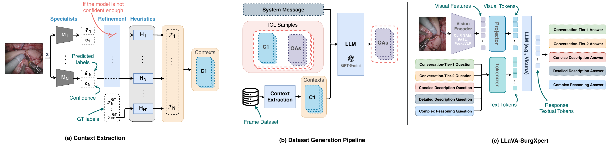
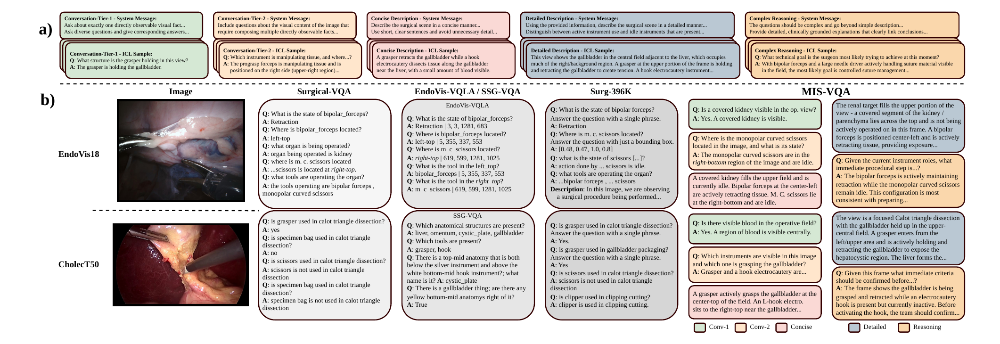

<h1 align="center">
  <picture>
    <source media="(prefers-color-scheme: dark)" srcset="assets/logo-dark.svg">
    
  </picture>
</h1>

<p align="center">
  <b>MIS-VQA: An Annotation-Driven Surgical Vision–Language Dataset for Complex Surgical Understanding</b><br>
  Mohamed Hamdy, Iheb Zouari, Fatmaelzahraa Ahmed, Muraam Abdel-Ghani, Muhammed Arsalan, Ponnuthurai Suganthan, Khalid Al-Jalham, Abdulaziz Al-Ali, Shidin Balakrishnan<br>
  <i>MICAD 2026</i>
</p>

<p align="center">
  <a href="https://arxiv.org/abs/2610.34210"></a>
  <a href="https://huggingface.co/datasets/M-Hamdy/MIS-VQA"></a>
</p>

<p align="center">849K question-answer pairs and scene descriptions for 32,545 frames from CholecT50 and EndoVis18.</p>

MIS-VQA is generated from existing surgical annotations. For each frame, the phase, instruments, action triplets, instrument-tissue interactions and segmentation masks are written into a text prompt, and GPT-5-mini writes questions and answers from it, guided by examples written by surgeons. Every frame has five response types: a concise and a detailed description, single-fact questions (Conv-1), questions that combine several facts (Conv-2), and complex reasoning.



| | CholecT50 train | CholecT50 test | EndoVis18 train | EndoVis18 test |
|---|:---:|:---:|:---:|:---:|
| Frames | 27,063 | 3,247 | 1,788 | 447 |
| Concise | 27,063 | 3,247 | 1,788 | 447 |
| Detailed | 27,063 | 3,247 | 1,788 | 447 |
| Conv-1 | 254,819 | 30,386 | 18,080 | 4,854 |
| Conv-2 | 234,573 | 28,117 | 16,251 | 4,149 |
| Reasoning | 157,384 | 19,069 | 12,632 | 3,233 |
| Total | 700,902 | 84,066 | 50,539 | 13,130 |

LLaVA-SurgXpert is LLaVA-1.5 (Vicuna-7B) with an interchangeable vision encoder: CLIP, SAM, FASL or PeskaVLP.

## Contents

The dataset is on Hugging Face at [M-Hamdy/MIS-VQA](https://huggingface.co/datasets/M-Hamdy/MIS-VQA); this repository holds the code.

```
surgxpert.py          vision encoders, data conversion and training entry point
zero2.json            DeepSpeed config (from LLaVA)
demo.ipynb            loads the dataset and shows it with the source images
```

The dataset is gated: accept the conditions on its page and log in with `hf auth login`.

```python
from datasets import load_dataset

cholec = load_dataset("M-Hamdy/MIS-VQA", "cholect50")      # train: 27,063 frames, 45 videos; test: 3,247 frames, 5 videos
endovis = load_dataset("M-Hamdy/MIS-VQA", "endovis18")     # train: 1,788 frames, 12 sequences; test: 447 frames, 3 sequences
```

## Format

Each row is one frame:

```python
{"image": "VID01/000000.png", "video": 1, "frame": 0,
 "concise": "A grasper is actively grasping the gallbladder during preparation. ...",
 "detailed": "The view focuses on the gallbladder, which is being actively held by a grasper ...",
 "conv1": [{"question": "Is a grasper visible in this image?", "answer": "Yes, a grasper is visible."}, ...],
 "conv2": [{"question": "Which instruments are visible in this frame?", "answer": "A single laparoscopic grasper is visible; ..."}, ...],
 "reasoning": [{"question": "Given the grasper is actively holding the gallbladder during the preparation phase ...", "answer": "..."}, ...]}
```

`conv1`, `conv2` and `reasoning` are lists of question-answer pairs. `concise` and `detailed` answer the prompts "Describe the surgical scene concisely." and "Describe the surgical scene in detail." The same data is in the `json/` folder of the dataset, with the pairs as `[question, answer]`; this is the format read by `surgxpert.py`.

For CholecT50, `image` is `VIDxx/NNNNNN.png` under `CholecT50/videos/` and `frame` is the CholecT50 frame index (1 fps). Use the CholecT50 frames, not frames extracted from the Cholec80 videos.

For EndoVis18, `video` is the sequence and `image` is `seq_X/left_frames/frameNNN.png` from the EndoVis 2018 Robotic Scene Segmentation training set.

The images are not included. Request CholecT50 from [CAMMA](https://github.com/CAMMA-public/cholect50) and EndoVis 2018 from the [challenge website](https://endovissub2018-roboticscenesegmentation.grand-challenge.org/).

## Splits

- CholecT50: test videos 5, 12, 26, 27 and 31, which are the Cholec80-VQA test videos available in CholecT50. The remaining 45 videos are used for training.
- EndoVis18: test sequences 1, 5 and 16, as in EndoVis-18-VQA. The remaining sequences are used for training.

## Sources

For CholecT50, the phase and action triplets come from CholecT50, instrument presence from Cholec80, and instrument and anatomy positions from CholecSeg8k masks or, where these are not available, FASL predictions. Frames are sampled at 1 fps when the phase, instrument or triplet labels change.

For EndoVis18, all frames are used. Positions come from the EndoVis 2018 scene labels, and instrument actions from the interaction labels of Islam et al.

## Comparison with existing datasets

| Dataset | Public | Procedures | Images | Samples | Spatial | Template Q | Template A | Captions | Reasoning |
|---|:---:|:---:|:---:|:---:|:---:|:---:|:---:|:---:|:---:|
| EndoVis-18-VQA | ✓ | 1 | 2K | 11.8K | Endo | ✓ | ✓ | ✗ | ✗ |
| Cholec80-VQA | ✓ | 1 | 21.6K | 43K | ✗ | ✓ | ✓ | ✗ | ✗ |
| SSG-VQA | ✓ | 1 | 25K | 960K | Endo | ✓ | ✓ | ✗ | ✗ |
| Surg-396K | ✓ | 3 | 41.4K | 396K | Endo | ✗ | ✗ | ✓ | ✗ |
| SurgVLM | ✗ | 16 | 1810K | 7798K | – | ✗ | ✗ | – | – |
| **MIS-VQA** | ✓ | 2 | 33K | 849K | ✓ | ✗ | ✗ | ✓ | ✓ |

Template Q/A: template-based questions/answers (paper, Table 1).



## Results

Normalized GPT-Score on the test splits (paper, Table 2). GPT-5-nano rates predicted and reference answers against the annotation context of the frame; the paper also reports cosine similarity, BLEU, METEOR and CIDEr.

| Model | Conv-1 | Conv-2 | Concise | Detailed | Reasoning |
|---|:---:|:---:|:---:|:---:|:---:|
| **EndoVis18** | | | | | |
| VisualBert | 59.37 | 41.98 | – | – | – |
| VisualBert-RM | 50.70 | 43.32 | 21.85 | – | – |
| EndoChat | 60.95 | 51.60 | 24.32 | 21.43 | 70.76 |
| LLaVA-SurgXpert (PeskaVLP) | 55.29 | 46.85 | 22.71 | 24.91 | 76.60 |
| LLaVA-SurgXpert (FASL) | 60.98 | 51.82 | **36.17** | **39.98** | **78.47** |
| LLaVA-SurgXpert (SAM) | **62.51** | **52.61** | 29.46 | 31.47 | 78.44 |
| LLaVA-SurgXpert (CLIP) | 61.06 | 47.55 | 26.27 | 28.53 | 77.16 |
| **CholecT50** | | | | | |
| EndoChat | **73.15** | **70.52** | 47.55 | 46.75 | 80.47 |
| LLaVA-SurgXpert (SAM) | 66.99 | 65.37 | **52.05** | **51.60** | **81.92** |
| LLaVA-SurgXpert (FASL) | 59.57 | 55.54 | 41.04 | 39.11 | 80.83 |
| LLaVA-SurgXpert (CLIP) | 64.44 | 62.75 | 48.45 | 47.56 | 81.42 |

## LLaVA-SurgXpert

`surgxpert.py` adds four vision encoders to [LLaVA](https://github.com/haotian-liu/LLaVA) without modifying it. Each frame is center-cropped to 1024×1024 (zero-padded if smaller) and resized to the encoder's input size without normalization, and the encoder output is mapped to 32×32 = 1024 visual tokens.

| Encoder | `--vision_tower` | Input | Features | Weights |
|---|---|:---:|---|---|
| CLIP ViT-B/16 | `clip-336-b16` | 336 | 21×21×768, resized to 32×32 | [openai/clip-vit-base-patch16](https://huggingface.co/openai/clip-vit-base-patch16) |
| SAM ViT-B | `sam-b` | 1024 | 64×64×256, pixel-unshuffled to 32×32×1024 | [facebook/sam-vit-base](https://huggingface.co/facebook/sam-vit-base) |
| FASL | `fasl-cholec`, `fasl-endovis18` | 512 | 128×128×64, pixel-unshuffled to 32×32×1024 | `fasl_cholec.pth`, `fasl_endovis18.pth` |
| PeskaVLP | `peskavlp` | 224 | 7×7×2048, pixel-shuffled to 28×28×128, resized to 32×32 | [`PeskaVLP.pth`](https://seafile.unistra.fr/f/65a2b1bf113e428280d0/?dl=1), from [SurgVLP](https://github.com/CAMMA-public/SurgVLP) |

CLIP and SAM are downloaded from Hugging Face. Put the FASL checkpoints and `PeskaVLP.pth` (extracted from the zip) in `weights/` in the repository root, and run the commands below from there.

```bash
conda create -n misvqa python=3.10 -y && conda activate misvqa
pip install -U pip && pip install -r requirements.txt
hf download M-Hamdy/MIS-VQA --repo-type dataset --include "json/*" --local-dir data
python -c "from surgxpert import to_llava; to_llava('data/json/cholect50/train.json.gz', 'pretrain.json', ['concise', 'detailed'])"
python -c "from surgxpert import to_llava; to_llava('data/json/cholect50/train.json.gz', 'finetune.json')"
```

The encoder stays frozen. Stage 1 trains the projector on the descriptions and stage 2 trains the projector and LoRA adapters on all response types:

```bash
ARGS="--deepspeed zero2.json --model_name_or_path lmsys/vicuna-7b-v1.5 --version v1 --vision_tower sam-b
      --image_folder CholecT50/videos --mm_projector_type mlp2x_gelu --mm_use_im_patch_token False
      --per_device_train_batch_size 16 --lr_scheduler_type cosine --warmup_ratio 0.03 --model_max_length 2048
      --gradient_checkpointing True --lazy_preprocess True --bf16 True --tf32 True
      --dataloader_num_workers 4 --save_steps 1000 --save_total_limit 1 --report_to none"

deepspeed surgxpert.py $ARGS --data_path pretrain.json --tune_mm_mlp_adapter True \
    --num_train_epochs 2 --learning_rate 1e-3 --output_dir checkpoints/llava-surgxpert-sam-b-pretrain

deepspeed surgxpert.py $ARGS --data_path finetune.json \
    --pretrain_mm_mlp_adapter checkpoints/llava-surgxpert-sam-b-pretrain/mm_projector.bin \
    --lora_enable True --lora_r 128 --lora_alpha 256 --mm_projector_lr 2e-5 \
    --image_aspect_ratio pad --group_by_modality_length True \
    --num_train_epochs 1 --learning_rate 2e-5 --output_dir checkpoints/llava-surgxpert-sam-b-lora
```

For EndoVis18, convert `data/json/endovis18/train.json.gz`, set `--image_folder` to the directory with the `seq_X` folders and use `fasl-endovis18` instead of `fasl-cholec`.

To answer questions, import `surgxpert` before loading the trained checkpoint. The checkpoint folder name must contain `llava` and `lora` for LLaVA to load it correctly.

```python
import torch
from PIL import Image
import surgxpert
from llava.constants import DEFAULT_IMAGE_TOKEN, IMAGE_TOKEN_INDEX
from llava.conversation import conv_templates
from llava.mm_utils import get_model_name_from_path, process_images, tokenizer_image_token
from llava.model.builder import load_pretrained_model

path = "checkpoints/llava-surgxpert-sam-b-lora"
tokenizer, model, processor, _ = load_pretrained_model(path, "lmsys/vicuna-7b-v1.5", get_model_name_from_path(path))

def ask(image, question):
    conv = conv_templates["llava_v1"].copy()
    conv.append_message(conv.roles[0], DEFAULT_IMAGE_TOKEN + "\n" + question)
    conv.append_message(conv.roles[1], None)
    ids = tokenizer_image_token(conv.get_prompt(), tokenizer, IMAGE_TOKEN_INDEX, return_tensors="pt")[None].cuda()
    image = Image.open(image).convert("RGB")
    pixels = process_images([image], processor, model.config).to(model.device, torch.float16)
    out = model.generate(ids, images=pixels, image_sizes=[image.size], do_sample=False, max_new_tokens=512)
    return tokenizer.decode(out[0], skip_special_tokens=True).strip()

print(ask("CholecT50/videos/VID05/000010.png", "Which instruments are visible in this image?"))
```

## Citation

**If you use MIS-VQA or LLaVA-SurgXpert, please cite our paper:**

```bibtex
@inproceedings{hamdy2026misvqa,
  title     = {MIS-VQA: An Annotation-Driven Surgical Vision--Language Dataset for Complex Surgical Understanding},
  author    = {Hamdy, Mohamed and Zouari, Iheb and Ahmed, Fatmaelzahraa and Abdel-Ghani, Muraam and Arsalan, Muhammed and Suganthan, Ponnuthurai and Al-Jalham, Khalid and Al-Ali, Abdulaziz and Balakrishnan, Shidin},
  booktitle = {Medical Imaging and Computer-Aided Diagnosis (MICAD)},
  year      = {2026},
  eprint    = {2610.34210},
  archivePrefix = {arXiv},
  primaryClass = {cs.CV},
  url       = {https://arxiv.org/abs/2610.34210}
}
```

<details>
<summary>Source datasets (please cite these <b>in addition to</b> MIS-VQA)</summary>

MIS-VQA is built on the CholecT50 frames and labels, the Cholec80 instrument labels, CholecSeg8k and FASL predictions, the EndoVis 2018 frames and scene labels and the interaction labels of Islam et al. The test splits follow Surgical-VQA.

```bibtex
@article{nwoye2022rendezvous,
  title   = {Rendezvous: Attention Mechanisms for the Recognition of Surgical Action Triplets in Endoscopic Videos},
  author  = {Nwoye, Chinedu Innocent and Yu, Tong and Gonzalez, Cristians and Seeliger, Barbara and Mascagni, Pietro and Mutter, Didier and Marescaux, Jacques and Padoy, Nicolas},
  journal = {Medical Image Analysis},
  volume  = {78},
  pages   = {102433},
  year    = {2022}
}

@article{twinanda2017endonet,
  title   = {EndoNet: A Deep Architecture for Recognition Tasks on Laparoscopic Videos},
  author  = {Twinanda, Andru P. and Shehata, Sherif and Mutter, Didier and Marescaux, Jacques and de Mathelin, Michel and Padoy, Nicolas},
  journal = {IEEE Transactions on Medical Imaging},
  volume  = {36},
  number  = {1},
  pages   = {86--97},
  year    = {2017}
}

@article{hong2020cholecseg8k,
  title   = {CholecSeg8k: A Semantic Segmentation Dataset for Laparoscopic Cholecystectomy Based on Cholec80},
  author  = {Hong, W.-Y. and Kao, C.-L. and Kuo, Y.-H. and Wang, J.-R. and Chang, W.-L. and Shih, C.-S.},
  journal = {arXiv preprint arXiv:2012.12453},
  year    = {2020}
}

@inproceedings{abdelghani2025fasl,
  title     = {FASL-Seg: Anatomy and Tool Segmentation of Surgical Scenes},
  author    = {Abdel-Ghani, Muraam and Ali, Mahmoud and Ali, Mohamed and Ahmed, Fatmaelzahraa and Arsalan, Muhammad and Al-Ali, Abdulaziz and Balakrishnan, Shidin},
  booktitle = {European Conference on Artificial Intelligence (ECAI)},
  pages     = {1001--1008},
  year      = {2025}
}

@article{allan2020endovis18,
  title   = {2018 Robotic Scene Segmentation Challenge},
  author  = {Allan, Max and Kondo, Satoshi and Bodenstedt, Sebastian and Leger, Stefan and Kadkhodamohammadi, Rahim and Luengo, Imanol and Fuentes, Felix and Flouty, Evangello and Mohammed, Ahmed and Pedersen, Marius and others},
  journal = {arXiv preprint arXiv:2001.11190},
  year    = {2020}
}

@inproceedings{islam2020learning,
  title     = {Learning and Reasoning with the Graph Structure Representation in Robotic Surgery},
  author    = {Islam, Mobarakol and Seenivasan, Lalithkumar and Ming, Lim Chwee and Ren, Hongliang},
  booktitle = {Medical Image Computing and Computer Assisted Intervention (MICCAI)},
  pages     = {627--636},
  year      = {2020}
}

@inproceedings{seenivasan2022surgicalvqa,
  title     = {Surgical-VQA: Visual Question Answering in Surgical Scenes Using Transformer},
  author    = {Seenivasan, Lalithkumar and Islam, Mobarakol and Krishna, Adithya K. and Ren, Hongliang},
  booktitle = {Medical Image Computing and Computer Assisted Intervention (MICCAI)},
  pages     = {33--43},
  year      = {2022}
}
```

</details>

## License

The dataset and code are released for **non-commercial use only**, under [CC BY-NC-SA 4.0](https://creativecommons.org/licenses/by-nc-sa/4.0/) (see [LICENSE](LICENSE)), consistent with CholecT50, Cholec80 and CholecSeg8k. The source images and labels are not redistributed and remain subject to their own terms. The text was generated with GPT-5-mini and is subject to the OpenAI Terms of Use. Models trained with this code inherit the terms of their components: LLaVA (Apache-2.0), Vicuna (Llama 2 Community License), PeskaVLP (CC BY-NC-SA 4.0) and the SegFormer backbone of FASL (NVIDIA non-commercial license). The resizing and token alignment in `surgxpert.py` follow [Eagle](https://github.com/NVlabs/EAGLE) (Apache-2.0).

## Acknowledgements

This work was supported by the Qatar Research Development and Innovation Council (QRDI), grant ARG01-0522-230266.

## Contact

Questions, issues and suggestions are welcome. Please open a [GitHub issue](https://github.com/M-Hamdy-M/MIS-VQA/issues) or [contact me](mailto:mm1905748@qu.edu.qa).
